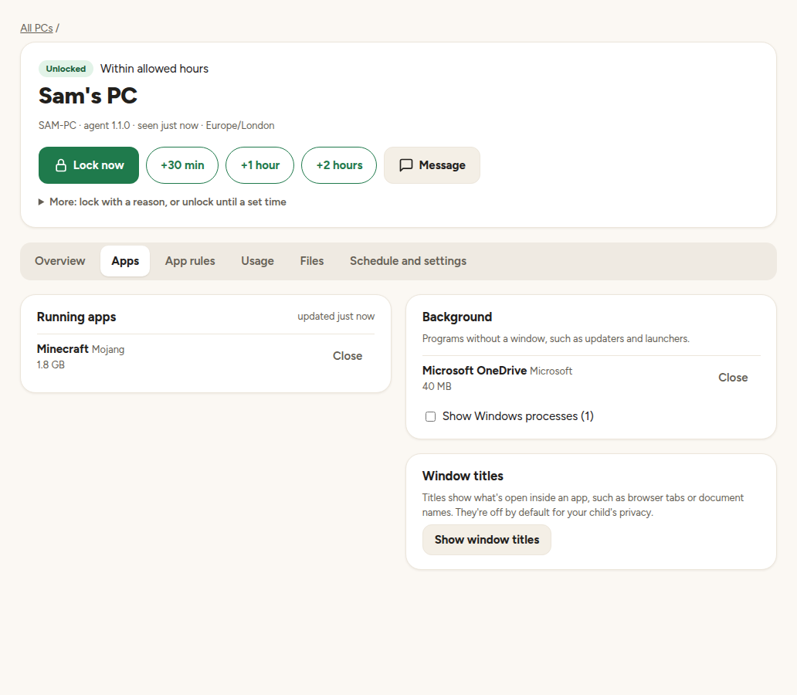
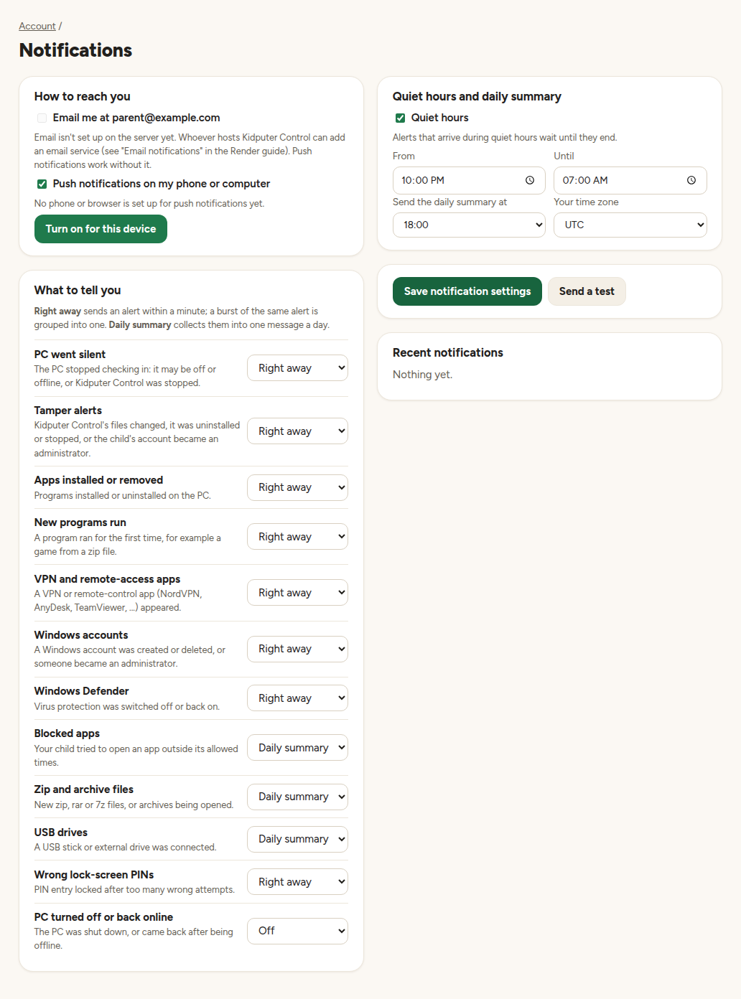
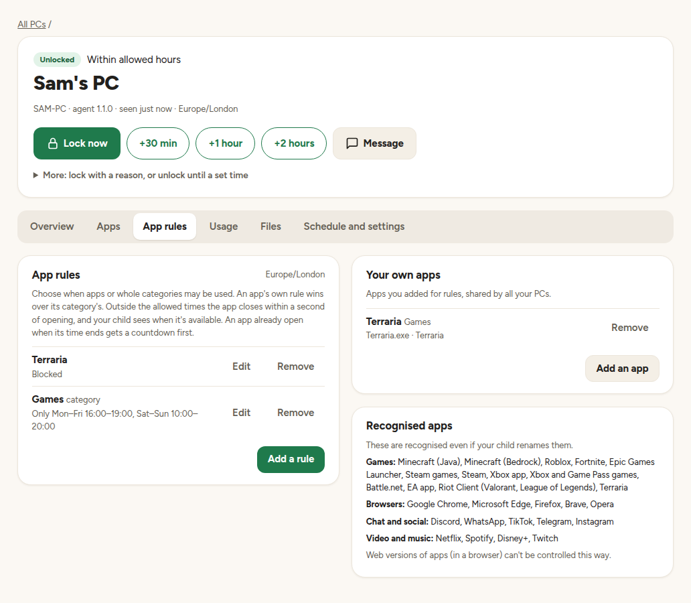
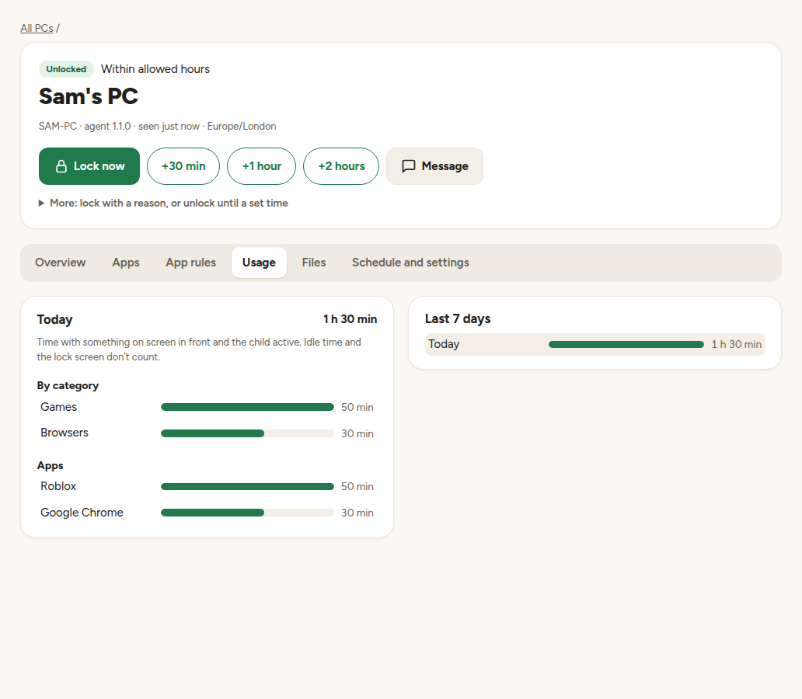
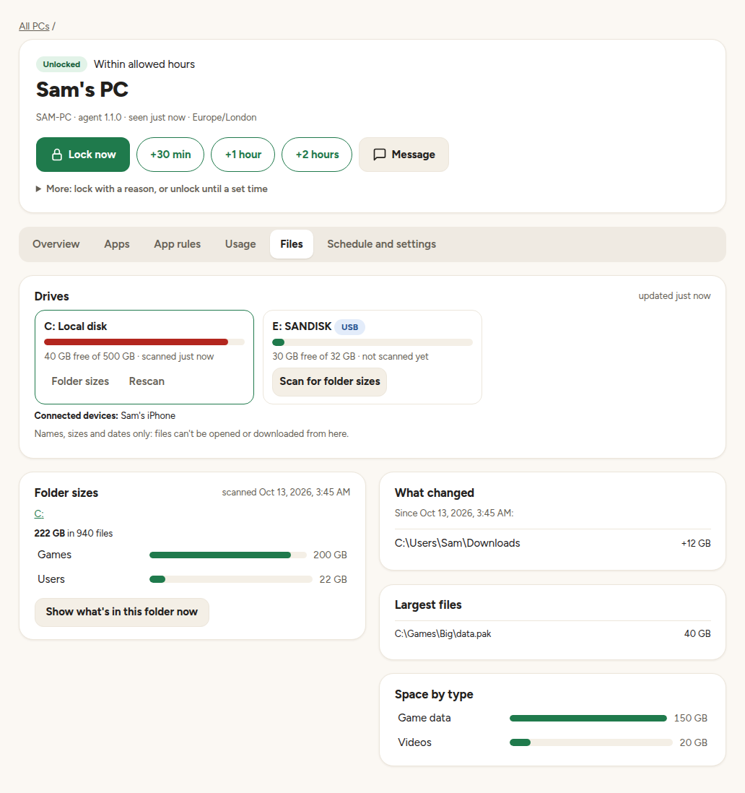
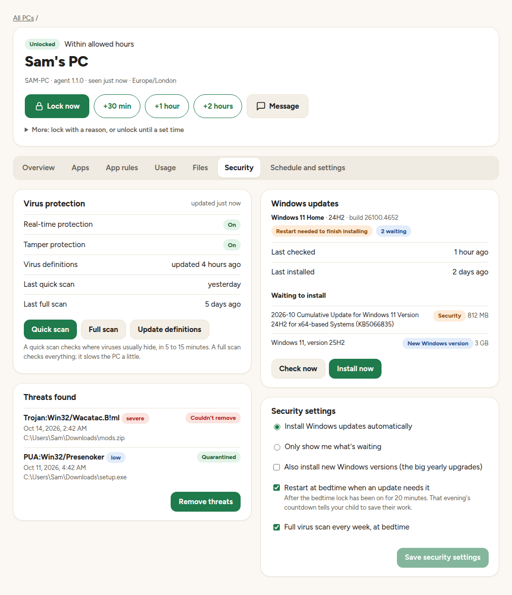
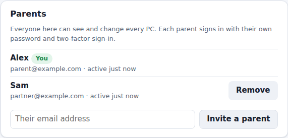

# Kidputer Control

A parental-control system for Windows 11 PCs. You set a bedtime schedule from a web dashboard.
The child's PC shows a countdown and then locks, and it keeps enforcing the schedule even when
it's offline. From any browser or phone, a parent can lock the PC right away, grant extra time,
send an on-screen message, see which apps are running and close one. Parents get alerts by email
or on their phone, and everything that happens is recorded in one central activity log.


## What it does

- **Made for phones too:** each PC's card shows how long until bedtime, with big **Lock now**,
  **+30 min** and **Message** buttons. On a phone the dashboard has a menu bar along the bottom,
  like an app; on a computer, a sidebar lists your PCs. A bar shows each PC's day hour by hour:
  when it's allowed, locked, or has extra time.
  Light and dark themes: it follows your device, or pick one under Account → Appearance.
- **Bedtime schedule:** a lock window for each night of the week, in the PC's own time zone. A
  countdown (5 minutes by default) warns the child before the PC locks.
- **Lock now:** an immediate lock that applies even during extra time.
- **Extra time:** +30 minutes, +1 hour, +2 hours, or until a chosen time.
- **On-screen messages:** either *closable* by the child, or *persistent* until a parent removes
  them.
- **Running apps:** see what's open on the child's PC right now, and close an app remotely. By
  default the child gets a one-minute warning to save first. Windows itself and Kidputer Control
  can't be closed this way.
- **Notifications:** by email and as phone push notifications (the dashboard installs as a phone
  app). Choose per type: right away, a daily summary, or off. Quiet hours hold alerts overnight,
  and repeats are grouped into one alert.
- **"PC went silent" alerts:** if a PC stops checking in, parents are told. When it's back, the
  alert says whether the PC was simply off or Kidputer Control was stopped while Windows ran.
- **App schedules:** choose when apps or whole categories (games, browsers, chat, video) may be
  used, per weekday, or block them. Outside the allowed times an app closes as soon as it opens,
  and the child sees when it's available; an app already open gets a countdown. Renamed copies are
  still recognised. Add your own apps, picked from the ones your child has used.
- **Usage time:** time per app and per category each day, counting only the app in front and not
  idle time.
- **Files:** every drive with its free space, connected phones, and folder sizes like TreeSize:
  click through folders sorted by size, the largest files, space by type, and what grew since the
  last scan. Ask the PC what's in a folder right now. Names, sizes and dates only: files can't be
  opened or downloaded. Drives are scanned weekly in the background, or when you ask.
- **Security:** Microsoft Defender's status, the threats it found and what it did about them, and
  buttons for a quick or full scan, updating virus definitions and removing threats. Windows
  updates waiting, installed automatically (or only shown, if you prefer), with the restart they
  need done at bedtime, and never over a metered connection or on a low battery. On Windows Pro,
  your child can't pause updates. Alerts for threats, no recent virus scan, failed updates, and
  updates being paused. Each PC's card
  on the home page says "Protected and up to date", or what needs attention.
- **Change monitoring:** parents hear about apps installed or removed, programs run for the first
  time (for example a game straight from a zip), new zip files, USB drives, new Windows accounts or
  administrators, Defender being switched off, and VPN or remote-control apps.
- **Managed or Trusted mode:** Managed (recommended) is for a child with a standard Windows
  account, who can't switch Kidputer Control off. Trusted is for a child with an administrator
  account: the schedule still applies, and notifications are the safety net.
- **Lock-screen PIN:** a parent standing at the PC can type the PIN to unlock it. Too many wrong
  attempts lock PIN entry for a while.
- **Tamper resistance:**
  - The enforcement process runs as SYSTEM, so a standard user can't stop or remove it.
  - If the child closes the lock screen, it comes back within about a second.
  - The installed files are checked against a fingerprint every minute.
- **Automatic updates:** the PC installs new versions of Kidputer Control by itself. Every file is
  checked against a fingerprint first, and a failed update is rolled back. It can be turned off per
  PC.
- **Central activity log:** locks, unlocks, wrong PINs, messages, tamper alerts, and parent
  actions. You can filter by PC, importance, and source.
- **Offline-safe:** the PC enforces from its last-synced copy of the settings. Only remote actions
  need a connection.
- **Secure dashboard:**
  - Sign in with a **passkey** (Face ID, fingerprint, Windows Hello), or with a password plus a
    mandatory authenticator-app code.
  - **"Remember this device"** skips the code on your own phone or computer.
  - Risky changes, such as deleting a PC or changing its PIN, still ask you to **confirm it's
    you**.
  - The Account page lists every **signed-in device** and lets you sign any of them out.
  - Repeated failed sign-ins lock the account temporarily.
- **Several parents:** each parent has their own sign-in. Invite another parent from the Account
  page with a one-time link, remove a parent there too, and see who did what in the activity log.
- **Reversible:** locking always uses the Windows lock (`LockWorkStation`). Nothing is ever shut
  down, so no work is lost.

| A PC's page | On a phone |
|---|---|
|  |  |

| Running apps | Notification settings |
|---|---|
|  |  |
| **App rules** | **Usage** |
|  |  |

Files: drives, folder sizes, what changed, and the largest files:



Security: virus protection and Windows updates:



The Parents section of the Account page:



## Video guides

**[Watch the video guides on YouTube](https://www.youtube.com/playlist?list=PLR4GI8Rc_Nl4)**

Nine short narrated videos cover the tour, setting up on Render, installing on the child's PC,
everyday use from a phone, app rules and files, the Security tab, parents and sign-in security, the
real-PC checklist, and an overview for developers. The dashboard's **Help** page links to them
too. They're recorded from the real dashboard and can be re-recorded after the design changes: see
[docs/VIDEOS.md](docs/VIDEOS.md).

## How it fits together

```
 Parent's browser / phone ──HTTPS──▶  Render: FastAPI + React dashboard ──▶ Postgres
                                                  ▲
 Child's PC:  SYSTEM watchdog ──HTTPS (device token)┘
                  │ launches into the child's session
                  ▼
              Lock screen / countdown / messages (WinForms)
```

- **Cloud (`server/`, `web/`):**
  - One Docker image on Render runs both the dashboard and the API, on the same web address.
  - Postgres stores the schedule, overrides, messages, lock requests, and the activity log.
- **PC agent (`agent/`):** PowerShell 5.1, which is built into Windows, so there's nothing to
  install first.
  - A **SYSTEM watchdog**, run as a scheduled task, decides when to lock, checks PINs, syncs with
    the cloud, and watches for tampering.
  - A **UI agent** runs in the child's session and shows the countdown, the lock screen, and
    messages.
  - The UI agent never sees the PIN hash; the watchdog checks every attempt.

## Repository layout

| Path | What |
|---|---|
| `server/` | FastAPI + Postgres API: schema and migrations, dashboard sign-in (password + TOTP, passkeys), parent accounts and invites, device management, and the agent sync protocol |
| `web/` | Parent dashboard: React + TypeScript (Vite) |
| `agent/` | Windows agent: SYSTEM watchdog, UI agent, installer and uninstaller, tests |
| `Dockerfile`, `render.yaml` | Single-image build and Render Blueprint (web service + Postgres) |
| `docs/ROADMAP.md` | Planned features, with effort, feasibility and practicality |
| `docs/DEPLOY-RENDER.md` | Step-by-step deployment and first sign-in |
| `docs/ARCHITECTURE.md` | Design decisions, data model, agent protocol |
| `agent/README.md` | Installing on the child's PC, plus a first-run checklist |
| `CLAUDE.md` | Working notes for Claude Code sessions: conventions, commands, traps, status |
| `tools/render_readme_pdf.py` | Regenerates `README.pdf` from `README.md` |

## Getting started

1. **Deploy the cloud side to Render:** New → Blueprint → pick this repo. Enter your email and a
   first password when asked. Full steps are in [docs/DEPLOY-RENDER.md](docs/DEPLOY-RENDER.md).
2. **Sign in** and set up two-factor sign-in (scan the QR code). Then remove the bootstrap
   password from Render's environment settings.
3. **Add a PC** in the dashboard and click **Download installer**.
4. **Install on the child's PC:** unzip the download there and double-click **Install Kidputer
   Control**. Approve the Windows permission prompt and pick the child's account from the list.
   The child should use a **standard** (non-administrator) Windows account. Installing by hand
   with `Install.ps1` is also possible; see [agent/README.md](agent/README.md).
5. Set the **schedule** and a **lock-screen PIN** on the device's page. Then walk through the
   first-run checklist in [agent/README.md](agent/README.md) once.
6. **Optional, add the other parent:** under **Account → Parents**, enter their email and send
   them the one-time link. They choose their own password and set up their own two-factor
   sign-in.

**Running locally:**

```bash
KC_BOOTSTRAP_ADMIN_EMAIL=you@example.com KC_BOOTSTRAP_ADMIN_PASSWORD='a long local password' \
  docker compose up --build      # dashboard + API on http://localhost:8000
```

For dashboard development with hot reload, run `cd web && npm install && npm run dev`.

## Testing

| Suite | What it covers |
|---|---|
| `server/tests` (pytest, real Postgres) | API, auth and 2FA, passkeys (with a software authenticator), remembered devices, parent invites and removal, modes, notifications (grouping, quiet hours, digests, encrypted push, "PC went silent"), running apps and commands, auto-update, app rules and custom apps, usage, drives and scans ("what changed"), lockouts, the agent protocol, UTC windows across daylight saving, serving the dashboard |
| `server/tests/test_agent_integration.py` | The agent's PowerShell code against a live API (enroll, sync, events, PIN unlock, commands and reports, downloading and installing an update, a real folder-size scan uploaded) |
| `server/tests/test_dashboard_e2e.py` | The whole parent journey in Chromium: passkeys with a virtual authenticator, inviting and removing a second parent, notification settings, running apps and closing one, app rules and custom apps, usage, the Files tab, the Security tab, and phone-width layout checks |
| `web` (Vitest) | Status, time, schedule, app-grouping, rule-description, duration and size helpers |
| `agent/tests` | Decision logic, countdown, PIN lockout, queue, inbox, tamper check, install modes, closing apps, app matching and rules, usage counting, change monitoring, the folder-size scanner, folder listing, auto-update (fingerprints, install, rollback), Defender threats and Windows update decisions, script parsing, interop compile |

CI runs all of these. The agent tests run on Windows under both PowerShell 5.1 and 7.

## Status

Version 1.3.0. Everything planned for 1.0 to 1.3 is built: the cloud API, the agent, the SYSTEM
watchdog, the dashboard (redesigned in 1.3), modes, notifications, running apps, automatic updates,
change monitoring, app schedules and usage, the Files tab, and the Security tab (virus protection
and Windows updates).

**Not yet verified on a real PC:** the parts that need an interactive Windows session. These are
the lock-screen windows, launching into the child's session, the scheduled task, the folder
permissions, closing apps, the shutdown signal, installing an update, change monitoring, app
rules, usage sampling, drive scans, and the Security tab's Defender scans, Windows updates and
restarts. Before relying on the agent, run through the checklist in
`agent/README.md` once.

## Roadmap

The full plan, with effort, feasibility and practicality for each feature, is in
[docs/ROADMAP.md](docs/ROADMAP.md). In short:

| Version | Planned |
|---|---|
| **1.0.x** | Verify on a real Windows PC and fix what turns up. One-click installer download (done). |
| **1.1 (done)** | Managed (standard account) and Trusted (administrator account) modes, chosen in the installer. Parent notifications by email and push, including when a PC goes silent. See running apps and stop them remotely. Agent auto-update. Sign in with passkeys and remember trusted devices. Several parents with their own sign-ins. |
| **1.2 (done)** | Notifications for major changes: app installs, programs run for the first time, archives, new accounts, Defender, USB drives. A file explorer for the PC's drives with folder-size analysis, like TreeSize. Schedule when common apps are available. Add custom apps. Per-app usage time. |
| **1.3 (done)** | A new dashboard look, built for phones. The Security tab: virus protection and Windows updates. Narrated video guides. |
| **1.4** | Install requests that a parent approves (Managed mode). Daily screen-time quotas, an "ask for more time" button, schedule templates and holidays. |
| **Later** | Weekly email reports, a bonus-time bank, several children per PC. |

## Recent changes

- **Since 1.3.0 (on DEV, not yet released):**
  - **Help page:** "Help and videos" in the sidebar (and **Help** in the top bar on a phone) links
    to the video guides on YouTube, with a few common questions and the version you're running.
  - **Light or dark:** the dashboard follows your phone or computer's setting, or you can choose
    Light or Dark under **Account → Appearance** (remembered on that phone or computer).
  - **Dark mode fixes:** the locked part of the hour-by-hour bar is striped so it shows up in the
    dark, the Delete device button is easier to read, and a PC that's offline shows its countdown
    greyed out (it can't count down without the PC).
  - **Tidier pages:** the bedtime schedule spans the full width of Schedule and settings, and the
    home page's "Today" list leaves out parent sign-ins (they're still in Activity).

- **Version 1.3.0:**
  - **Security tab:**
    - **Virus protection:** Defender on or off, tamper protection, how old the virus definitions
      are, the last scans, and every threat found with what Defender did about it. Quick scan, full
      scan, update definitions, and remove threats from the dashboard; a full scan every week at
      bedtime.
    - **Windows updates:** the Windows version, what's waiting, and when updates last installed.
      Installed automatically (monthly and security updates; the big yearly upgrades only if you
      tick it), not on a low battery or a metered connection such as mobile data. When an update
      needs a restart, the PC restarts at bedtime, and that evening's countdown tells your child to
      save their work. On Windows Pro, Education and Enterprise, the "Pause updates" button is hidden
      from your child (Windows Home doesn't allow that, so you're alerted instead).
    - **Alerts:** a threat found (right away), a threat that couldn't be removed, out-of-date virus
      definitions, no virus scan for two weeks, failed updates, a restart waiting for days, and updates paused or switched off.
  - **New dashboard look:**
    - Warm colours and a friendlier font, the same on a computer and a phone.
    - **Home:** a card per PC with the time left until bedtime and big Lock now, +30 min and Message
      buttons, next to today's events.
    - **A PC's page:** the countdown and all the quick actions at the top, a bar showing the day
      hour by hour, the apps open right now with Close buttons, and the message box. The schedule and
      settings moved to their own **Schedule and settings** section.
    - **On a computer** a sidebar lists your PCs with a coloured dot for each one's status. **On a
      phone** a menu bar along the bottom takes you to Home, Activity, Alerts and Account.
  - **Video guides:** nine narrated videos recorded from the real dashboard (a tour, setup on
    Render, installing on the PC, using it from a phone, and more). See
    [docs/VIDEOS.md](docs/VIDEOS.md).

- **Version 1.2.0:**
  - **Change monitoring:** alerts for apps installed or removed, programs run for the first time
    (for example straight from a zip), new zip files, USB drives, new Windows accounts or
    administrators, Defender switched off, and VPN or remote-control apps. The first two days only
    learn what's normal.
  - **App rules** tab: allow, block, or schedule apps and whole categories per weekday; the PC
    closes an app opened outside its times and says when it's available. Add your own apps,
    picked from the ones your child has used.
  - **Usage** tab: screen time per day, by category and by app (only the app in front, not idle
    time), and the last 7 days.
  - **Files** tab: drives, folder sizes like TreeSize, largest files, space by type, what grew
    since the last scan, and a live look into any folder. Names, sizes and dates only.
  - On phones, the device page's tabs wrap onto two lines.

- **Version 1.1.0:**
  - **Managed and Trusted modes:** choose in the installer dialog or on the device page; no
    reinstall needed to switch. Trusted mode accepts an administrator child account. A Managed PC
    whose child account is an administrator shows a warning.
  - **Notifications:** Account → Notification settings. Push works without setup; email needs an
    SMTP service (see [docs/DEPLOY-RENDER.md](docs/DEPLOY-RENDER.md)). Every alert type can be
    right away, in the daily summary, or off, with quiet hours.
  - **"PC went silent":** an alert when a PC stops checking in (15 minutes by default, per PC).
    Normal shutdowns and sleep are recognised, and a restart after Kidputer Control was stopped
    while Windows ran raises a tamper alert.
  - **Running apps:** the device page has tabs; the new **Apps** tab lists what's open, with a
    **Close** button. Window titles are off by default for privacy.
  - **Automatic agent updates** from the server, verified file by file, with rollback.
  - The PC checks in every few seconds while you have a live page open, so app lists and closing
    respond quickly.

- **Several parents:**
  - **Invite a parent:** on the Account page, enter their email to get a one-time sign-up link.
    Send it yourself; it works once and expires after 48 hours. They choose a name and password,
    then set up their own two-factor sign-in.
  - **Remove a parent:** signs them out everywhere and stops them signing in. The activity log
    keeps their name.
  - **Who did what:** activity entries show the parent's name instead of just "Parent".
  - **Your name:** set the name the other parents see, on the Account page.
  - Inviting and removing parents ask you to confirm it's you, like other risky changes.
  - Adding a second parent no longer needs the Render Shell.

- **Passkeys and remembered devices:**
  - **Passkeys:** sign in with Face ID, a fingerprint, or Windows Hello. A passkey counts as
    two-factor sign-in on its own, and the authenticator code stays as a backup.
  - **Remember this device for 30 days:** skips the code on your own browser.
  - **Confirm it's you:** risky changes ask for a passkey or code if you haven't confirmed in the
    last 10 minutes.
  - **Account page:** new sections for passkeys, signed-in devices, and remembered devices.

- **One-click installer:**
  - **Download installer** in the dashboard produces a zip with the agent, your server's address,
    and a one-time enrollment code.
  - On the PC: double-click **Install Kidputer Control**, approve the Windows permission prompt,
    and pick the child's account from a list.
  - Installing by hand still works, and `Install.ps1` now offers the same account list when
    `-ChildUser` is left out.

- **Renamed to Kidputer Control, version 1.0.0:**
  - The product was renamed from Session Monitor, and the version reset to 1.0.0.
  - Install paths on the PC are now `%ProgramFiles%\KidputerControl` and
    `%ProgramData%\KidputerControl`, and the scheduled task is `\KidputerControl\Watchdog`.
  - Settings use the `KC_` prefix, and the Render service is named `kidputer-control`.

- **Dashboard polish:**
  - At phone width, the extra-time row and the schedule table no longer overflow their card. The
    browser test now checks for this.
  - Times show with two-digit hours (03:15 rather than 3:15).
  - Activity entries use plain-English labels.
- **Step 4, web dashboard and Render hosting:**
  - React + TypeScript dashboard: sign-in with mandatory 2FA, devices overview, device page (lock
    now, extra time, messages, schedule, settings, PIN, enrollment), activity log, and account
    page. It works on phones and supports light and dark themes.
  - The server serves the dashboard with a strict Content-Security-Policy.
  - The first admin can be created from environment variables, because Render's free tier has no
    shell.
  - A single-image `Dockerfile`, the `render.yaml` Blueprint, and a deployment guide.
- **Steps 2–3, Windows agent:**
  - SYSTEM watchdog, lock-screen UI agent, installer and uninstaller.
  - Offline-safe enforcement from a local cache, with an idempotent event upload queue.
  - PBKDF2 PIN checks and lockout, handled by the watchdog.
  - The countdown deadline survives reboots.
  - Tamper detection, and relaunching of the UI if it's closed.
- **Server additions:**
  - Lock windows are precomputed in UTC for the next 14 days, which keeps them correct across
    daylight saving and stops the child dodging them by changing time zones.
  - A lock-screen PIN unlock shows up in the dashboard, and it ends an immediate lock.
- **Step 1, cloud API:**
  - FastAPI + Postgres schema.
  - Password and TOTP sign-in with CSRF protection and lockouts.
  - Device enrollment codes and tokens.
  - Central activity log.
