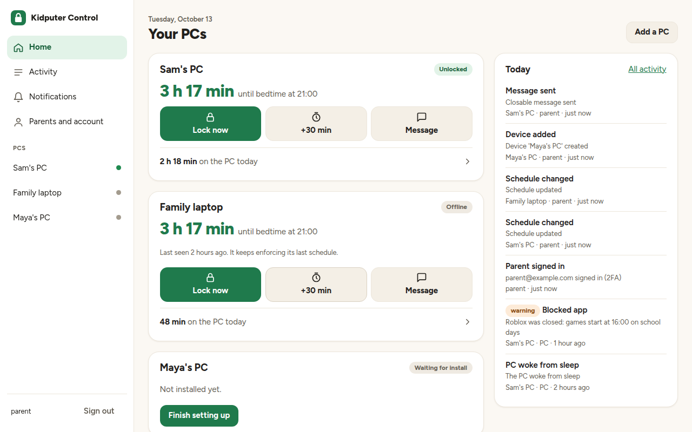
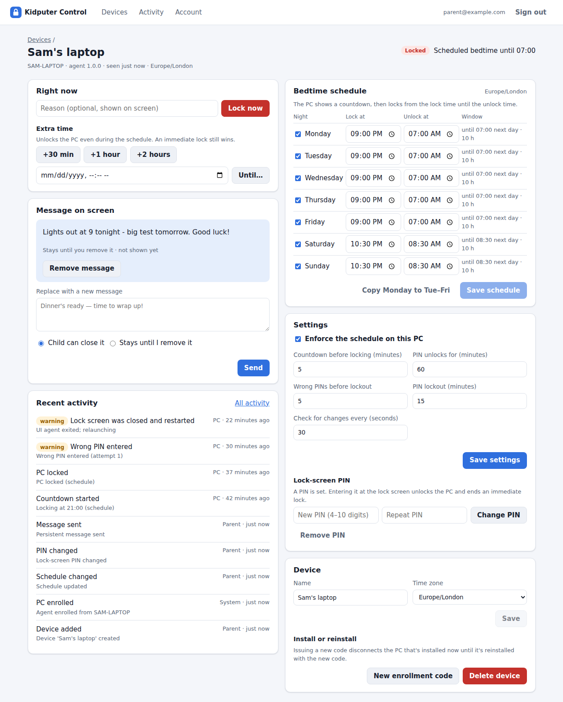
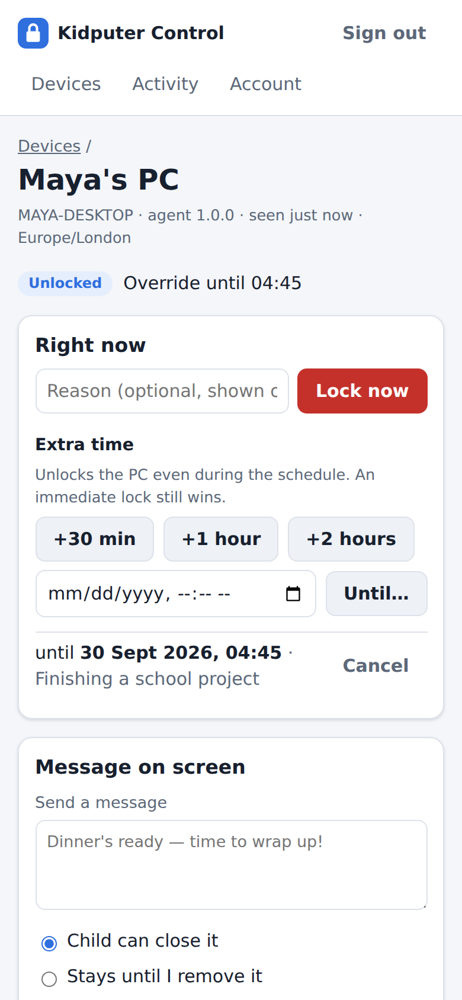

# Kidputer Control

A parental-control system for Windows 11 PCs. You set a bedtime schedule from a web dashboard.
The child's PC shows a countdown and then locks, and it keeps enforcing the schedule even when
it's offline. From any browser or phone, a parent can lock the PC right away, grant extra time,
or send an on-screen message. Everything that happens is recorded in one central activity log.



## What it does

- **Bedtime schedule:** a lock window for each night of the week, in the PC's own time zone. A
  countdown (5 minutes by default) warns the child before the PC locks.
- **Lock now:** an immediate lock that applies even during extra time.
- **Extra time:** +30 minutes, +1 hour, +2 hours, or until a chosen time.
- **On-screen messages:** either *closable* by the child, or *persistent* until a parent removes
  them.
- **Lock-screen PIN:** a parent standing at the PC can type the PIN to unlock it. Too many wrong
  attempts lock PIN entry for a while.
- **Tamper resistance:**
  - The enforcement process runs as SYSTEM, so a standard user can't stop or remove it.
  - If the child closes the lock screen, it comes back within about a second.
  - The installed files are checked against a fingerprint every minute.
- **Central activity log:** locks, unlocks, wrong PINs, messages, tamper alerts, and parent
  actions. You can filter by PC, importance, and source.
- **Offline-safe:** the PC enforces from its last-synced copy of the settings. Only remote actions
  need a connection.
- **Secure dashboard:**
  - Sign in with a **passkey** (Face ID, fingerprint, Windows Hello), or with a password plus a
    mandatory authenticator-app code.
  - **"Remember this device"** skips the code on your own phone or computer.
  - Risky changes, such as deleting a PC or changing its PIN, still ask you to **confirm it's
    you**.
  - The Account page lists every **signed-in device** and lets you sign any of them out.
- **Several parents:** each parent has their own sign-in. Invite another parent from the Account
  page with a one-time link, remove a parent there too, and see who did what in the activity log.
  - Repeated failed sign-ins lock the account temporarily.
- **Reversible:** locking always uses the Windows lock (`LockWorkStation`). Nothing is ever shut
  down, so no work is lost.

| Device page | On a phone |
|---|---|
|  |  |

## How it fits together

```
 Parent's browser / phone ──HTTPS──▶  Render: FastAPI + React dashboard ──▶ Postgres
                                                  ▲
 Child's PC:  SYSTEM watchdog ──HTTPS (device token)┘
                  │ launches into the child's session
                  ▼
              Lock screen / countdown / messages (WinForms)
```

- **Cloud (`server/`, `web/`):**
  - One Docker image on Render runs both the dashboard and the API, on the same web address.
  - Postgres stores the schedule, overrides, messages, lock requests, and the activity log.
- **PC agent (`agent/`):** PowerShell 5.1, which is built into Windows, so there's nothing to
  install first.
  - A **SYSTEM watchdog**, run as a scheduled task, decides when to lock, checks PINs, syncs with
    the cloud, and watches for tampering.
  - A **UI agent** runs in the child's session and shows the countdown, the lock screen, and
    messages.
  - The UI agent never sees the PIN hash; the watchdog checks every attempt.

## Repository layout

| Path | What |
|---|---|
| `server/` | FastAPI + Postgres API: schema and migrations, dashboard sign-in (password + TOTP), device management, and the agent sync protocol |
| `web/` | Parent dashboard: React + TypeScript (Vite) |
| `agent/` | Windows agent: SYSTEM watchdog, UI agent, installer and uninstaller, tests |
| `Dockerfile`, `render.yaml` | Single-image build and Render Blueprint (web service + Postgres) |
| `docs/ROADMAP.md` | Planned features, with effort, feasibility and practicality |
| `docs/DEPLOY-RENDER.md` | Step-by-step deployment and first sign-in |
| `docs/ARCHITECTURE.md` | Design decisions, data model, agent protocol |
| `agent/README.md` | Installing on the child's PC, plus a first-run checklist |
| `CLAUDE.md` | Working notes for Claude Code sessions: conventions, commands, traps, status |
| `tools/render_readme_pdf.py` | Regenerates `README.pdf` from `README.md` |

## Getting started

1. **Deploy the cloud side to Render:** New → Blueprint → pick this repo. Enter your email and a
   first password when asked. Full steps are in [docs/DEPLOY-RENDER.md](docs/DEPLOY-RENDER.md).
2. **Sign in** and set up two-factor sign-in (scan the QR code). Then remove the bootstrap
   password from Render's environment settings.
3. **Add a PC** in the dashboard and click **Download installer**.
4. **Install on the child's PC:** unzip the download there and double-click **Install Kidputer
   Control**. Approve the Windows permission prompt and pick the child's account from the list.
   The child should use a **standard** (non-administrator) Windows account. Installing by hand
   with `Install.ps1` is also possible; see [agent/README.md](agent/README.md).
5. Set the **schedule** and a **lock-screen PIN** on the device's page. Then walk through the
   first-run checklist in [agent/README.md](agent/README.md) once.

**Running locally:**

```bash
KC_BOOTSTRAP_ADMIN_EMAIL=you@example.com KC_BOOTSTRAP_ADMIN_PASSWORD='a long local password' \
  docker compose up --build      # dashboard + API on http://localhost:8000
```

For dashboard development with hot reload, run `cd web && npm install && npm run dev`.

## Testing

| Suite | What it covers |
|---|---|
| `server/tests` (pytest, real Postgres) | API, auth and 2FA, lockouts, the agent protocol, UTC lock windows, serving the dashboard |
| `server/tests/test_agent_integration.py` | The agent's PowerShell code against a live API (enroll, sync, events, PIN unlock) |
| `server/tests/test_dashboard_e2e.py` | The whole parent journey in Chromium, including a phone-width layout check |
| `web` (Vitest) | Status, time, and schedule helpers |
| `agent/tests` | Decision logic, countdown, PIN lockout, queue, inbox, tamper check, script parsing, interop compile |

CI runs all of these. The agent tests run on Windows under both PowerShell 5.1 and 7.

## Status

Version 1.0.0. All four build steps are complete: the cloud API, the agent syncing through it, the SYSTEM
watchdog, and the web dashboard.

**Not yet verified on a real PC:** the parts that need an interactive Windows session. These are
the lock-screen windows, launching into the child's session, the scheduled task, and the folder
permissions. Before relying on the agent, run through the checklist in `agent/README.md` once.

## Roadmap

The full plan, with effort, feasibility and practicality for each feature, is in
[docs/ROADMAP.md](docs/ROADMAP.md). In short:

| Version | Planned |
|---|---|
| **1.0.x** | Verify on a real Windows PC and fix what turns up. One-click installer download (done). |
| **1.1** | Managed (standard account) and Trusted (administrator account) modes, chosen in the installer. Parent notifications by email and push, including when a PC goes silent. See running apps and stop them remotely. Agent auto-update. Sign in with passkeys and remember trusted devices (done). Several parents with their own sign-ins (done). |
| **1.2** | Notifications for major changes: app installs, programs run for the first time, archives, new accounts, Defender, USB drives. A file explorer for the PC's drives with folder-size analysis, like TreeSize. Schedule when common apps are available. Add custom apps. Per-app usage time. |
| **1.3** | Install requests that a parent approves (Managed mode). Daily screen-time quotas, an "ask for more time" button, schedule templates and holidays. |
| **Later** | Weekly email reports, a bonus-time bank, several children per PC. |

## Recent changes

- **Several parents:**
  - **Invite a parent:** on the Account page, enter their email to get a one-time sign-up link.
    Send it yourself; it works once and expires after 48 hours. They choose a name and password,
    then set up their own two-factor sign-in.
  - **Remove a parent:** signs them out everywhere and stops them signing in. The activity log
    keeps their name.
  - **Who did what:** activity entries show the parent's name instead of just "Parent".
  - **Your name:** set the name the other parents see, on the Account page.
  - Inviting and removing parents ask you to confirm it's you, like other risky changes.

- **Passkeys and remembered devices:**
  - **Passkeys:** sign in with Face ID, a fingerprint, or Windows Hello. A passkey counts as
    two-factor sign-in on its own, and the authenticator code stays as a backup.
  - **Remember this device for 30 days:** skips the code on your own browser.
  - **Confirm it's you:** risky changes ask for a passkey or code if you haven't confirmed in the
    last 10 minutes.
  - **Account page:** new sections for passkeys, signed-in devices, and remembered devices.

- **One-click installer:**
  - **Download installer** in the dashboard produces a zip with the agent, your server's address,
    and a one-time enrollment code.
  - On the PC: double-click **Install Kidputer Control**, approve the Windows permission prompt,
    and pick the child's account from a list.
  - Installing by hand still works, and `Install.ps1` now offers the same account list when
    `-ChildUser` is left out.

- **Renamed to Kidputer Control, version 1.0.0:**
  - The product was renamed from Session Monitor, and the version reset to 1.0.0.
  - Install paths on the PC are now `%ProgramFiles%\KidputerControl` and
    `%ProgramData%\KidputerControl`, and the scheduled task is `\KidputerControl\Watchdog`.
  - Settings use the `KC_` prefix, and the Render service is named `kidputer-control`.

- **Dashboard polish:**
  - At phone width, the extra-time row and the schedule table no longer overflow their card. The
    browser test now checks for this.
  - Times show with two-digit hours (03:15 rather than 3:15).
  - Activity entries use plain-English labels.
- **Step 4, web dashboard and Render hosting:**
  - React + TypeScript dashboard: sign-in with mandatory 2FA, devices overview, device page (lock
    now, extra time, messages, schedule, settings, PIN, enrollment), activity log, and account
    page. It works on phones and supports light and dark themes.
  - The server serves the dashboard with a strict Content-Security-Policy.
  - The first admin can be created from environment variables, because Render's free tier has no
    shell.
  - A single-image `Dockerfile`, the `render.yaml` Blueprint, and a deployment guide.
- **Steps 2–3, Windows agent:**
  - SYSTEM watchdog, lock-screen UI agent, installer and uninstaller.
  - Offline-safe enforcement from a local cache, with an idempotent event upload queue.
  - PBKDF2 PIN checks and lockout, handled by the watchdog.
  - The countdown deadline survives reboots.
  - Tamper detection, and relaunching of the UI if it's closed.
- **Server additions:**
  - Lock windows are precomputed in UTC for the next 14 days, which keeps them correct across
    daylight saving and stops the child dodging them by changing time zones.
  - A lock-screen PIN unlock shows up in the dashboard, and it ends an immediate lock.
- **Step 1, cloud API:**
  - FastAPI + Postgres schema.
  - Password and TOTP sign-in with CSRF protection and lockouts.
  - Device enrollment codes and tokens.
  - Central activity log.
